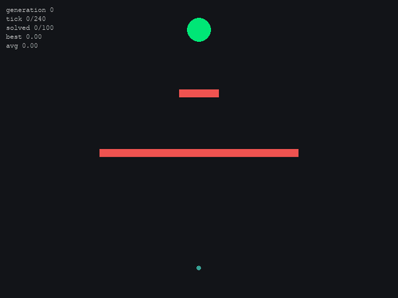
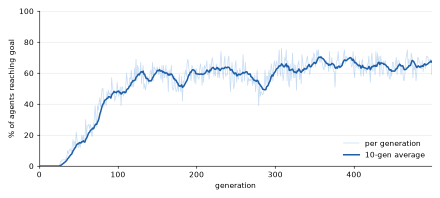

# Genetic Algorithm Sim

A population of 100 agents tries to get from the bottom of the screen to the green goal at the top without hitting the red walls. They start out moving completely randomly, and every generation the ones that did best get to pass on their genes, until most of them figure out a path around the walls.



The GIF shows generation 0, then 60, then 250.

## How it works

Each agent's DNA is a list of 240 force vectors, one for every tick of a generation. On each tick the agent adds that tick's force to its velocity (capped at 5 px/tick) and moves. If it hits a wall or the edge of the screen, it's dead for the rest of the generation.

At the end of the generation every agent gets a fitness score:

- `1000 / (distance to goal + 1)^1.5`, so the closer it ended up the higher the score, and it ramps up a lot near the goal
- reaching the goal adds 2000, plus 15 for every tick it had left, so getting there faster is better
- crashing multiplies the score by 0.1

Then the next generation gets built. The top 4% get copied straight over (elitism) so the best path never gets lost. Everyone else is a child of two parents, and each parent is picked by tournament selection (grab 4 random agents and take the best one). The child gets each gene from one parent or the other at random (uniform crossover), and then each gene has a 1.5% chance of getting replaced with a random force (mutation).

Tournament selection works better here than picking parents proportional to fitness. Once one agent reaches the goal its score is in the thousands while everyone else is under 1, so with proportional picking it would be basically the only parent and the population would lose all its variety.

The walls and goal size took some tuning. With the bottom wall wider and the goal smaller, the population pretty much never made it through.

## Results

From a 500 generation run (the data is in `ga_metrics.csv`):



The first agent reaches the goal around generation 26. After that its genes spread fast and the success rate climbs to around 60% by generation 150, then levels off between 60 and 70%. It never gets close to 100% because mutation keeps knocking some agents off the path every generation, and only the top 4% are protected from that.

## Running it

```bash
pip install -r requirements.txt
python main.py
```

Esc or closing the window stops it. `--headless` runs it without the window, which is way faster if you just want the stats (it also falls back to that automatically if pygame isn't installed). The other options are `--generations` (default 50), `--pop-size` (100), `--lifespan` (240), `--mutation-rate` (0.015), and `--csv-output` (ga_metrics.csv), which is where the per-generation stats get saved.

```bash
python main.py --headless --generations 500
```
